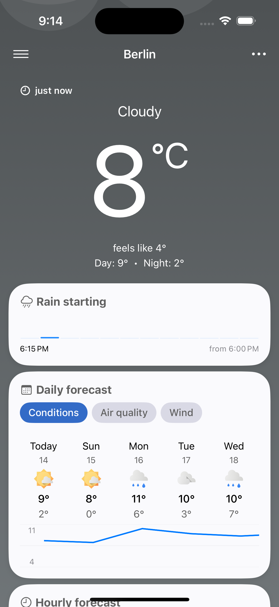
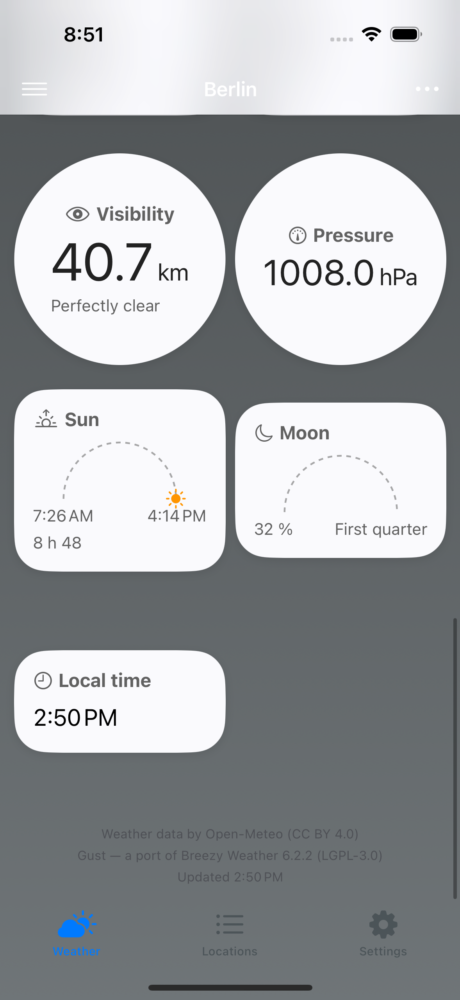

# Gust

[](https://github.com/PriyanshuNaredi/gust/actions/workflows/unsigned-ipa.yml)

An iOS port of [Breezy Weather](https://github.com/breezy-weather/breezy-weather) 6.2.2,
built by reading the upstream Kotlin rather than guessing at behaviour.

**Not affiliated with Breezy Weather.** The name "Gust" is deliberate: upstream's
`LICENSE_ADDITIONAL` prohibits misrepresenting the origin of the software, so this port
ships under its own name, its own icon, and ships LGPL-3.0 with the upstream notices.

| | |
|---|---|
| Source APK | `breezy-weather-v6.2.2_standard.apk`, SHA-256 `20a33a588e884257ab9329fee794d30a9d15ea067f64302c70c69c9adc3c6309` |
| Upstream tag | `v6.2.2` |
| Scope | Option A — see `SCOPE.md` |
| Weather source | Open-Meteo (forecast + air quality + geocoding) |
| Platform | iOS 17+, Swift 6 toolchain, Swift 5 language mode |
| Tests | 106 package + 10 UI, all green |
| Licence | LGPL-3.0, plus upstream's additional terms — see `LICENSE`, `LICENSE_ADDITIONAL` |
| Status | Feature-complete for its scope, not a finished product — `PROJECT_STATUS.md` lists exactly what is and is not done |

## What it does

- **Main screen** — upstream's animated weather background: the three-stop gradient
  asset chosen by condition, day/night and theme, with its geometric scene over it
  (rotating sun squares, breathing cloud circles, rain streaks, snowflakes, hail, wind
  gusts, night stars, meteors, thunder flash), and the header, then the card stack
  with its half/full layout rule: 15-minute nowcast (Canvas), daily and hourly cards with
  Conditions / Air quality / Wind tabs, then precipitation (day or night, named after what
  is in it), wind with a direction arrow, air quality as a ring, pollen with upstream's
  per-type severity, humidity, UV, visibility, pressure, sun, moon, local time and the
  attribution footer.
- **Detail pages** — a date selector, a Daytime/Nighttime panel, a category menu, and
  charts drawn with `Canvas`: hourly (temperature over precipitation probability), daily
  range bars, one series per metric card, four pollutant lines for air quality.
- **Locations** — saved places with search over Open-Meteo geocoding, selection and
  removal, persisted between launches.
- **Settings** — temperature, wind, pressure, precipitation and distance units, all
  wired to live formatting; licence and notice texts in-app.

There is no bottom tab bar, because upstream has none: the place list is behind the
top-left button and settings sit behind the overflow menu.




*(Simulator captures, iOS 18, Berlin, live Open-Meteo data.)*

## Build

```bash
./07_tools/macos-build.sh --run      # build + install + launch on a simulator
./07_tools/macos-tests.sh all        # package tests, then UI tests
./07_tools/ipa-build.sh 0.1.0        # unsigned IPA for SideStore/LiveContainer
```

Requires Xcode with the iOS 17 SDK and [XcodeGen](https://github.com/yonaskolb/XcodeGen)
(`brew install xcodegen`). No Apple ID, team or provisioning profile is used anywhere:
both the simulator build and the IPA are unsigned by design.

## How it was built

The method, the evidence and the 42 catalogued defects found along the way live in a
companion set of notes that is not published yet; the port-specific evidence is here, in
`recon/`, `02_parity/` and the commit history. The short version:

1. Recon the APK, pin its checksum, and count *app* classes rather than library classes.
2. Read the upstream Kotlin at the matching tag; jadx output loses idioms and renames
   packages.
3. Port the arithmetic into a Swift package with the upstream's own test expectations.
4. Port the UI only after the data layer can be tested in milliseconds.
5. Verify with screenshots and measured layout, not with "it looks right".

## What is not here

Recorded as deviations in `02_parity/PARITY_SPEC.md`, with a reason for each:

- **No alerts card.** No source in this port sends weather alerts, so the card is absent
  rather than permanently empty. The model and the notification rules are specified in
  `02_parity/PARITY_SPEC.md` for the provider that would restore it.
- **One weather source.** Open-Meteo only. Upstream ships 74 integrations; adding one here
  is a `WeatherProvider` conformance, not a refactor.
- **English only.** Upstream has 1,162 strings across 63 locales.
- **No widgets, live wallpaper, Wear OS, or map layers.** There is no iOS counterpart for
  the wallpaper or the tiles, and widgets would be a redesign rather than a transcription.
- **Untested on physical hardware.** No Apple ID or signing identity is used anywhere in
  this project; everything is simulator and host logic.
- **The app bar is a material blur, not the weather colour.** SwiftUI ignores a
  `toolbarBackground` colour that is derived from data loaded after the bar is built, and
  `toolbarBackgroundVisibility` is iOS 18+ while the deployment target is 17.
- **No degree days or deviation-from-normal.** Both need a 30-year climatology; a made-up
  baseline would be worse than its absence.

## Layout

```
SCOPE.md        what was cut and why
PROJECT_STATUS.md  stage-by-stage state, including what is unfinished
02_parity/      screen inventory, card catalog, deviation ledger, screenshots
recon/          facts extracted from the APK itself (checksum, strings, resources)
05_ios/
  BreezyUnits/  portable logic: units, Open-Meteo, AQI, nowcast, layout, preferences
  Gust/         the app: screens, cards, stores, the ported weather artwork
06_release/     unsigned IPA output (generated, not tracked)
07_tools/       build, test and packaging scripts
07_logs/        local build logs and screenshots (not tracked)
```

## Credits

Full attributions are in [`CREDITS.md`](CREDITS.md), and in-app under Settings → Licences.
In short:

- **Breezy Weather 6.2.2**, © the Breezy Weather contributors, LGPL-3.0 — the app this is
  a port of. Its source at tag `v6.2.2` is the specification; the port was written by
  reading it.
- **The weather artwork** is upstream's own (`app/src/main/res/drawable/weather_*.png`),
  redistributed under the same licence, unmodified. Only the *lookup* that picks an image
  for a condition was rewritten.
- **Open-Meteo** (<https://open-meteo.com>) provides forecast, air-quality and geocoding
  data under CC BY 4.0; the air-quality variables come from the Copernicus Atmosphere
  Monitoring Service. Attribution is shown on the main screen and in Settings, not just
  here.
- **The port** — app code, icon and packaging — is by Priyanshu Naredi.

Upstream's `LICENSE_ADDITIONAL` forbids suggesting that a modified version *is* the
original, and grants no trademark rights. Hence: a different name, a different icon, and
this notice.
